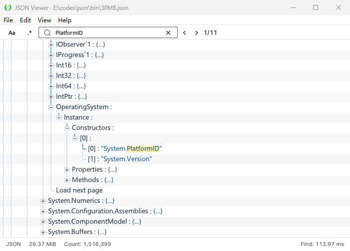

<div align="center">


# JSON Viewer

Windows x64 上的只读 JSON 和 JSON Lines 查看器。<br>
在折叠的文档中查找字段，从日志里挑出一条记录，复制它的路径或把它导出为 JSON。

**[下载便携 ZIP](https://github.com/Hunlongyu/json-viewer/releases/latest/download/json-viewer-windows-x64.zip)** · [下载单文件 EXE](https://github.com/Hunlongyu/json-viewer/releases/latest/download/json-viewer.exe) · [SHA-256 校验文件](https://github.com/Hunlongyu/json-viewer/releases/latest/download/checksums.txt)

[](https://github.com/Hunlongyu/json-viewer/releases)

</div>



## 第一次使用

1. 解压便携包，运行 `json-viewer.exe`。将文件拖入窗口，或按 `Ctrl+O` 打开文件。
2. 按 `Ctrl+F`，输入要找的键名或值，再按 `Enter`。查看器会展开到匹配项并高亮文字。按 `F3` 跳到下一处，按 `Shift+F3` 返回上一处。
3. 选中节点，按 `Ctrl+C` 复制值，或按 `Ctrl+P` 复制路径。要保存整个对象或数组，选中它并按 `Ctrl+E` 导出到新文件。

也可以从 PowerShell 直接打开日志。

```powershell
.\json-viewer.exe ".\events.jsonl"
```

## 浏览文档和日志

**普通 JSON** 按对象和数组展示，点击节点左侧的加号可逐层展开。UTF-8 JSON 文档可以使用任意后缀。打开 `.log`、`.config` 或无后缀文件时，在文件选择框中选择 `All files`。已复制到剪贴板的 JSON 可通过 `File → Open Clipboard...` 打开。

**JSON Lines** 按记录展示。打开 `.jsonl` 或 `.ndjson` 文件后，展开根节点即可逐条浏览。按 `End` 跳到末行，按 `Home` 返回首行。源文件在其他程序中更新后，按 `F5` 重新读取。

| 操作 | 用法 |
| --- | --- |
| 只搜键名、只搜值或搜索原文 | 在 `Edit → Search Scope` 中选择 `Keys`、`Values` 或 `Document Text`。默认同时搜索键和值。 |
| 区分大小写或使用正则表达式 | 点击查找栏中的 `Aa` 或 `.*`。 |
| 复制或导出子树 | 右键单击对象或数组，选择紧凑或格式化 JSON。 |
| 导出整份文档 | 选择 `File → Export Data As`。JSONL 支持原样导出。 |

按 `F1` 查看更多快捷键。最近打开的 8 个文件可从 `File → Open Recent` 找到。

## 字体与便携配置

通过 `View → Change Font...` 打开 Windows 字体对话框，调整树文字的字体、字形和字号。默认字体是 Segoe UI，大小为 13 个逻辑像素。对话框以磅为单位，可选 6 至 36 磅。

> [!TIP]
> 换电脑时，把 `json-viewer.exe` 和同目录的 `settings.ini` 一起复制，就能带走字体设置。程序目录不可写时，配置会保存到 `%LOCALAPPDATA%\JSON Viewer\settings.ini`。首次在可写目录中运行时，程序会沿用当前用户已有的设置。

检查新版本时，选择 `Help → Check For Update`。发现更新后，可在窗口内下载并重启安装。[查看发布记录](https://github.com/Hunlongyu/json-viewer/releases)

## 从源码构建

程序使用 C11、Win32 和 CUI。依赖归档随仓库提供，构建时会校验 SHA-256。[依赖说明](vendor/README.md)

在 Windows x64 上安装 Visual Studio C++ 构建工具、Windows SDK、CMake 3.24 或更高版本及 PowerShell 7，然后在仓库根目录运行打包命令。

```powershell
pwsh -File scripts/package-windows.ps1
```

可执行文件位于 `dist/windows-x64/json-viewer.exe`，便携包位于 `dist/json-viewer-windows-x64.zip`。

<details>
<summary>运行读取器、树视图和 Windows 界面回归测试</summary>

```powershell
cmake --build target/c-win64 --config MinSizeRel --target reader-test view-test --parallel
ctest --test-dir target/c-win64 -C MinSizeRel --output-on-failure
pwsh -File scripts/test-node-menu.ps1
pwsh -File scripts/test-document-switch.ps1
```

</details>
